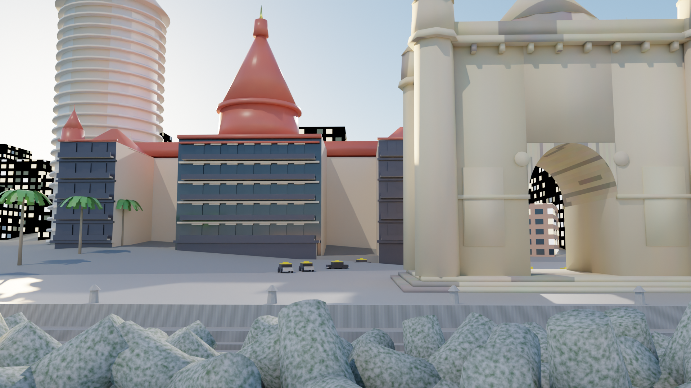
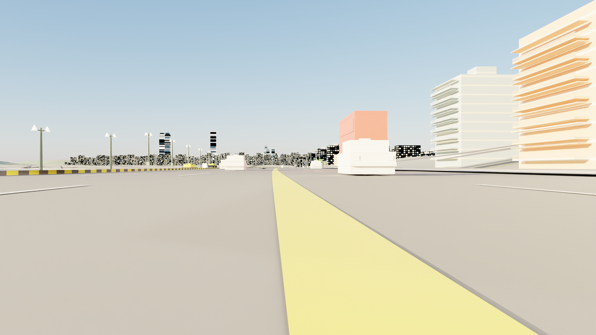
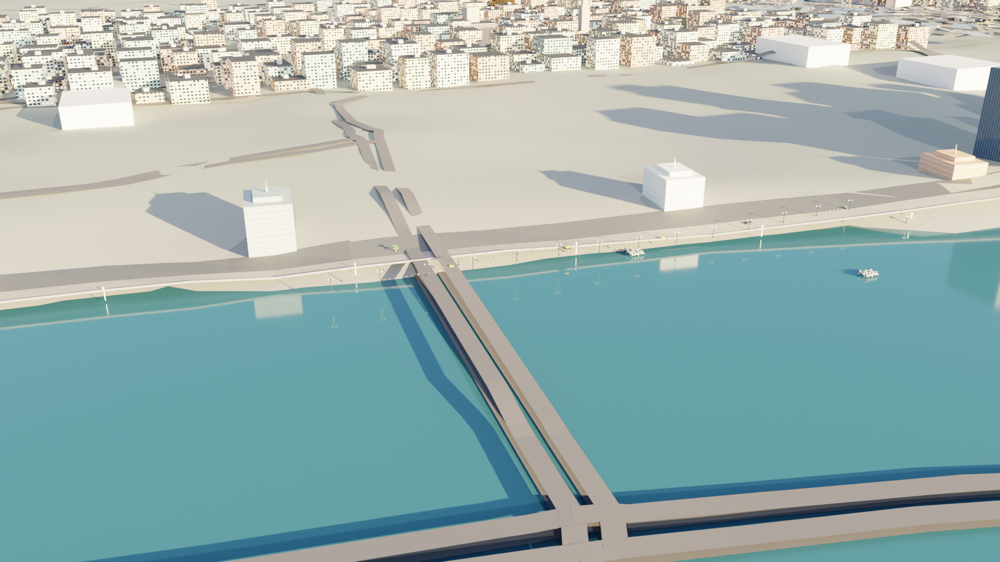

# GRAI — Photorealistic Mumbai 3D Digital Twin

High-fidelity geospatial 3D digital twin and playable architectural reconstruction of South & Central Mumbai built on real-world GIS elevation models and OpenStreetMap authoritative footprints.



---

## Overview & Key Features

This repository contains the complete, self-contained 3D digital twin of Mumbai:

1. **Master Blender Digital Twin (`GRAI_Mumbai_Digital_Twin.blend`)**:
   - **Autopacked & Standalone**: All procedural textures, shaders, and geometry are packed directly into the blendfile. It opens seamlessly on any computer (Mac Apple Silicon, Windows PC with NVIDIA RTX, or Linux) with zero missing assets or broken paths.
   - **Over 17,700+ Authentic Buildings**: Modeled real-world architectural footprints across Colaba, Fort Heritage District, Nariman Point, Marine Drive, Bandra, and Central Mumbai.
   - **Microscopic Rooftop & Facade Detailing**: A/C compressor units, Sintex water tanks, stairwell elevator mumtys, satellite dishes, and architectural balconies.

2. **Landmarks & Precincts**:
   - **Apollo Bunder Precinct**:
     - *Gateway of India*: Kharodi yellow basalt Indo-Saracenic triumphal arch with 3-foil horseshoe arch, perforated jali screens, bracketed chhajjas, and 4 corner minarets.
     - *Taj Mahal Palace & Tower*: 1903 heritage Indo-Gothic palace with Kurla basalt arcades, multi-tiered cantilevered balconies with wrought-iron railings, red Mangalore tile pitched roofs, and the iconic Florentine vermilion dome with gold finial. Adjoined by the 24-storey modernist Taj Tower.
     - *Harbour Breakwater*: High-density interlocking 4-legged concrete tetrapods lining the seawall against the Arabian Sea.
   - **Marine Drive & Back Bay (Queen's Necklace)**:
     - 6-lane Netaji Subhash Road with dark weathered asphalt, white dashed lane markings, double yellow median stripe, and pedestrian crosswalks.
     - Continuous alternating BMC Yellow and Black curb stones lining the promenade and median.
     - Two-tone interlocking stone promenade pavers and seawall balustrade.
     - Back Bay Arabian Sea water surface ($Z = 0.0\,\text{m}$) reflecting the coastal towers.
     - Authentic Mumbai traffic: Premier Padmini Kaali-Peeli black-and-yellow taxis and BEST red buses.
   - **CSMT (Victoria Terminus)**: Monumental Victorian Gothic railway terminus with central octagonal drum and dome.

3. **Geospatial Pipeline Scripts**:
   - Complete suite of reproducible Python automation scripts connecting directly to Blender's runtime via WebSocket (`blender_bridge.py`).

---

## Render Highlights

### Marine Drive Driver View (Netaji Subhash Road)


### Queen's Necklace High-Angle Vista


---

## How to Open on Any Device

### Requirements:
- **Blender 4.0 or higher** (Tested on Blender 4.3 & 5.2).

### Instructions:
1. Clone this repository:
   ```bash
   git clone https://github.com/Mokksh-bhatt/GRAI.git
   cd GRAI
   ```
2. Double-click or open `GRAI_Mumbai_Digital_Twin.blend` in Blender:
   ```bash
   blender GRAI_Mumbai_Digital_Twin.blend
   ```
3. To view any of the prepared hero viewpoints, switch the active camera:
   - `Cam_Apollo_Bandar_Hero` — Apollo Bunder & Gateway of India
   - `Cam_MarineDrive_Playable_Driver` — Marine Drive street perspective
   - `Cam_MarineDrive_QueensNecklace` — Queen's Necklace aerial sweep
   - `Cam_CSMT_Heritage` — Victoria Terminus heritage facade
   - `Cam_Mumbai_Overview` — Full South Mumbai peninsula overview
4. Press `F12` to render in Cycles (GPU Compute recommended).
